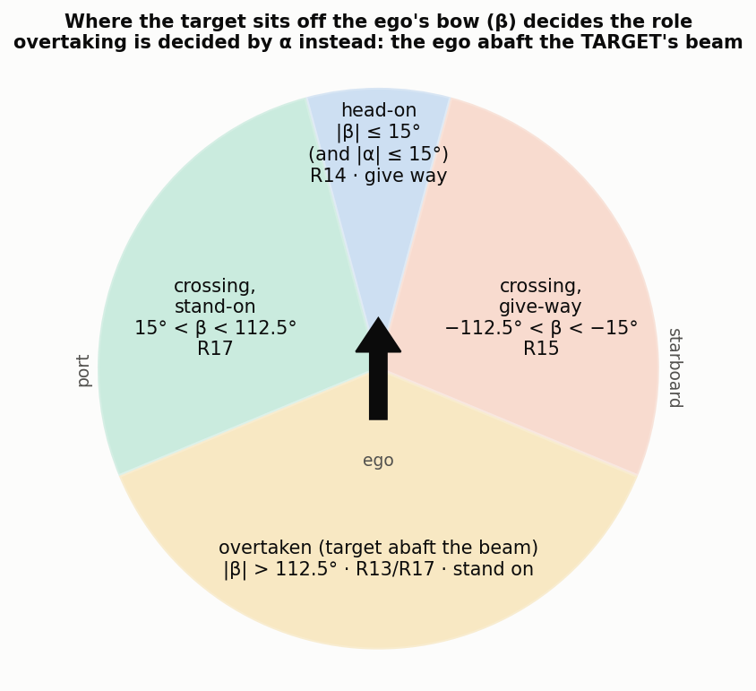
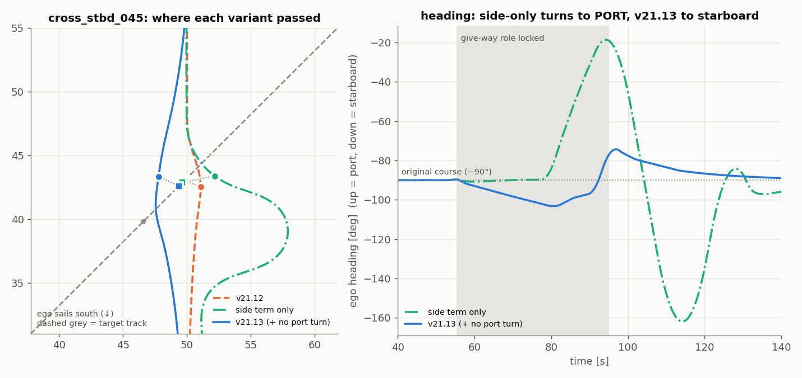
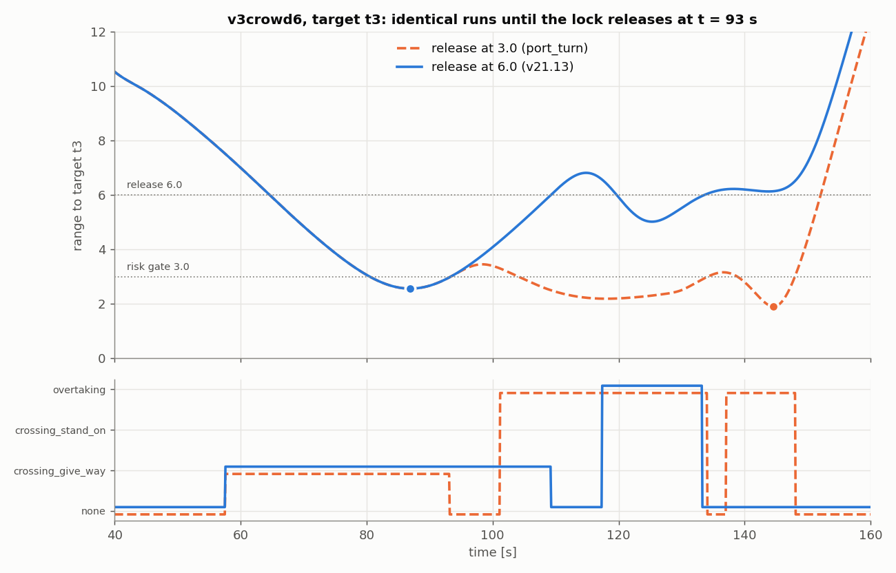
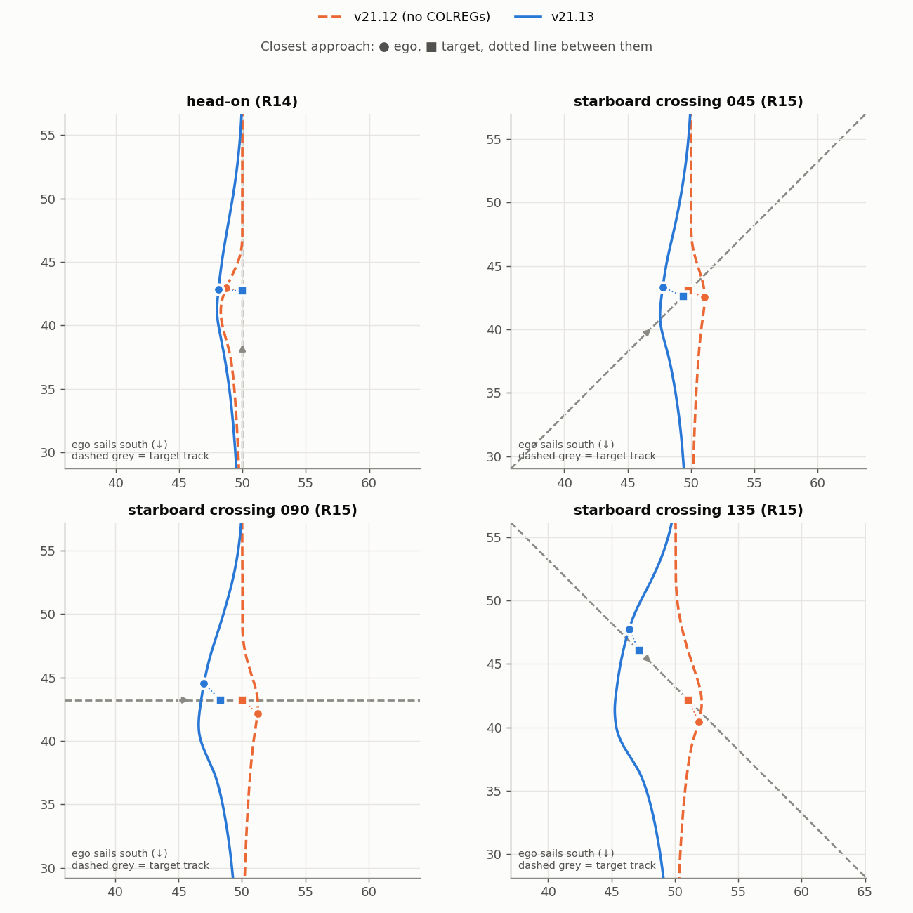

# v21.13 — basic COLREGs in the DWA cost

v21.13 is v21.12 plus one module, `DWAT_v4_st/colregs.py`. Nothing else in the
planner changed: Stage 1 is still `braking_rollout_static`, and the hull,
ramped rollout, horizons and the existing cost weights are all as in v21.12.

| on the 16 verified scenes (open water 13 + v3crowd 3) | v21.12 | **v21.13** |
|---|---|---|
| runs reaching the goal | 16 / 16 | **16 / 16** |
| head-on (R14) and give-way crossing (R15) encounters passed on the correct side | 7 / 20 | **18 / 18** |
| lowest clearance in any run | 0.524 | **0.539** |
| mean delay against the obstacle-free run | 5.6 s | **5.7 s** |

*(The encounter counts differ, 20 vs 18, because in the crowded scenes the
ego's earlier manoeuvres change which rule applies to a few later targets.)*

With `colregs_mode: "off"` the code is bit-identical to v21.12
(`owenc215_head_on`, 1519 steps, max trajectory difference 0.0), so every
earlier config still reproduces.

**Contents:** [1 Where it sits](#1-where-it-sits) ·
[2 Config keys](#2-config-keys) ·
[3 Step 1: classify each target](#3-step-1-classify-each-target-once-per-cycle) ·
[4 Step 2: the two costs](#4-step-2-the-two-costs-once-per-candidate) ·
[5 How the three terms were arrived at](#5-how-the-three-terms-were-arrived-at) ·
[6 Results](#6-results) · [7 Logging and scoring](#7-logging-and-scoring) ·
[8 What is not modelled](#8-what-is-not-modelled) · [9 Reproducing](#9-reproducing)

---

## 1. Where it sits

```
PathPlanning/
├── DWAT_v4_st/
│   ├── colregs.py                    NEW  classification, locks, the two costs
│   ├── dwa_ramped.py                 EDIT calls colregs once per cycle and once per candidate
│   └── dwa_average_weighted_side.py  EDIT Config gets the colregs_* keys (default "off")
└── DWAT_v5_modular/
    ├── algorithm.py                  EDIT writes roles and costs into each log entry
    ├── adapters/colregs_report.py    NEW  which side every target was passed on
    └── configs/algorithm/
        ├── v21.13.json               byte copy of v21.13/port_turn_release6.json
        └── v21.13/                   the sweep: side_only, port_turn, port_turn_release6
```

Only `dwa_ramped` reads the keys. Setting `colregs_mode` on a config that uses
the classic `dwa_average_weighted_side` module does nothing.

One control cycle in `dwa_ramped.dwa_control_merged` (★ = new):

```
state x = [x, y, yaw, v, omega], every dynamic obstacle (position, velocity)
│
├─★ colregs.classify(x, all obstacles)          once per cycle, UNFILTERED list
│     → a role per obstacle, and the ego heading each role locked at
│
├── filter_obstacles_by_direction(..., return_indices=True)
│     → the obstacles the cost sees, plus their original indices ("kept")
│
├─★ side_mask[j] = role of kept[j] is head_on or crossing_give_way
│   ref_yaw[j]   = heading that role locked at
│
└── calc_control_and_trajectory_merged(..., colregs_side_mask, colregs_ref_yaw)
      for each candidate (v, omega):
          Stage 1 braking test (braking_rollout_static)          unchanged
          rollout; goal, speed, static and dynamic costs         unchanged
        ★ side = colregs.side_cost(...); port = colregs.port_turn_cost(...)
          final_cost = goal + speed + static + dynamic + (side + port)
      pick the argmin
```

`classify` runs on the unfiltered list because a lock is keyed by obstacle
index, and only `map_manager.dynamic_obstacles` has an order that is fixed for
the whole run. The filter drops and re-indexes obstacles from cycle to cycle.

## 2. Config keys

Defined on `Config` in `dwa_average_weighted_side.py`. The defaults switch
everything off.

| key | default | v21.13 | meaning |
|---|---|---|---|
| `colregs_mode` | `"off"` | `"side_preference"` | master switch |
| `colregs_dcpa_gate` | 3.0 | 3.0 | risk of collision: DCPA at most this… |
| `colregs_tcpa_gate` | `None` | `None` | …and 0 < TCPA at most this; `None` → `predict_time_obstacle` (33.38 s) |
| `colregs_head_on_deg` | 15.0 | 15.0 | head-on sector, each side of the bow |
| `colregs_min_target_speed` | 0.05 | 0.05 | slower targets get no role |
| `colregs_release_dist` | `None` | **6.0** | unlock once opening beyond this; `None` → the DCPA gate |
| `colregs_side_cost_gain` | 0.5 | 0.5 | gain of the wrong-side penalty |
| `colregs_side_dist` | 4.0 | 4.0 | distance scale over which that penalty fades |
| `colregs_side_softness` | 0.2 | 0.2 | lateral scale of its sigmoid |
| `colregs_port_turn_gain` | 0.0 | **1.0** | cost per radian of altering to port of the locked heading; 0 → off |
| `colregs_turn_eval_time` | 10.0 | 10.0 | how far into a candidate that heading is read |

The three sweep configs differ only in the two bold keys (§5).

## 3. Step 1: classify each target (once per cycle)

### 3.1 Risk of collision: the CPA gate

Both vessels are assumed to hold their present velocity. With relative position
`r = q − p` and relative velocity `w = u − v_ego`:

```python
def _tcpa_dcpa(r, w):
    ww = float(w @ w)
    if ww < 1e-12:                                  # no relative motion: never closes
        return -math.inf, float(np.hypot(*r))
    tcpa = -float(r @ w) / ww                       # time of closest approach
    return tcpa, float(np.hypot(*(r + w * tcpa)))   # distance at that time
```

A target gets a role only if `0 < TCPA ≤ 33.38 s` and `DCPA ≤ 3.0`:

```python
tcpa, dcpa = _tcpa_dcpa(r, w)
if not (0.0 < tcpa <= tcpa_gate and dcpa <= dcpa_gate):
    roles.append(NONE)
```

This gate is why `null_safe_pass`, whose target passes about 6 u clear, is
bit-identical under v21.13: the layer never engages.

### 3.2 Which rule: two bearings

```python
beta  = _wrap(atan2(r_y, r_x) - yaw)                     # the target off the EGO's bow
alpha = _wrap(atan2(-r_y, -r_x) - atan2(u_y, u_x))       # the ego off the TARGET's bow
```

Angles are counter-clockwise, following the yaw convention: **positive is
port, negative is starboard.** The order of the tests matters:

```python
_STERN_SECTOR = math.radians(112.5)      # "abaft the beam": more than 22.5° behind abeam

def _role(beta, alpha, head_on):
    if abs(beta) <= head_on and abs(alpha) <= head_on:
        return HEAD_ON               # R14: each sees the other nearly dead ahead
    if abs(alpha) > _STERN_SECTOR:
        return OVERTAKING            # R13: the ego is in the target's stern sector
    if abs(beta) > _STERN_SECTOR:
        return OVERTAKEN             # R13/R17: the target is in the ego's stern sector
    return CROSSING_GIVE_WAY if beta < 0.0 else CROSSING_STAND_ON     # R15 / R17
```



| role | condition | rule | the ego must… | costed? |
|---|---|---|---|---|
| `head_on` | \|β\| ≤ 15° and \|α\| ≤ 15° | R14 | alter to starboard; pass port-to-port | **yes** |
| `crossing_give_way` | target on the starboard side | R15 | keep out of the way; not cross ahead | **yes** |
| `crossing_stand_on` | target on the port side | R17 | keep course and speed | no, logged only |
| `overtaking` | ego abaft the target's beam | R13 | keep out of the way, either side | no, logged only |
| `overtaken` | target abaft the ego's beam | R13/R17 | stand on | no, logged only |

Checked against the suite's own geometry, 30 s before each planned meeting,
all 11 single-target cases get the role their manifest names.

### 3.3 Locking and release

Once classified, a target keeps its role and stores the ego heading at that
moment. The per-run state is keyed by the run's `Config` object:

```python
_STATE = weakref.WeakKeyDictionary()
#   _STATE[config]["locked"] = {obstacle_index: (role, yaw_at_lock)}

if i in locked:
    if float(r @ w) > 0.0 and rng > release:   # opening AND beyond 6.0: past and clear
        del locked[i]
    else:
        roles.append(locked[i][0])             # keep the role…
        ref_yaw.append(locked[i][1])           # …and the heading it locked at
        continue
...
locked[i] = (role, yaw)                        # first classification: lock it
```

**Why lock at all.** The manoeuvre changes the geometry it was based on. In a
head-on, once the ego alters to starboard the target's bearing moves onto the
port bow. Classified afresh, that is a port-side crossing: the ego becomes
stand-on, the rule switches off, and the ego turns back.

**Why the release is wider than the gate.** With both at 3.0 there is no
hysteresis. A target that ends up roughly parallel at about 3 u releases, then
re-enters the gate under new geometry as a *different* encounter. See §5.3.
Releasing at 6.0 is the code's version of COLREGs' "until she is finally past
and clear".

## 4. Step 2: the two costs (once per candidate)

Both costs apply only to `SIDE_RULE_ROLES = {HEAD_ON, CROSSING_GIVE_WAY}`. The
other three roles are classified and logged but cost nothing.

### 4.1 Wrong-side penalty: `side_cost`

Rule 14 (port-to-port) and Rule 15 (pass astern of a crosser from starboard)
reduce to one geometric condition: **at the closest approach, the target is on
the ego's port side.**

```python
times = np.arange(T) * dt
pred  = ob_pos[:, None, :] + ob_vel[:, None, :] * times[None, :, None]   # (N, T, 2), constant velocity
d     = pred - trajectory[None, :, 0:2]          # each target relative to the ego
dist  = np.hypot(d[..., 0], d[..., 1])
k     = np.argmin(dist, axis=1)                  # THIS candidate's CPA step with each target

yaw     = trajectory[k, 2]
lateral = -np.sin(yaw) * dx + np.cos(yaw) * dy   # target in the ego's body frame; > 0 = port
wrong   = 0.5 * (1.0 - np.tanh(lateral / (2.0 * soft)))     # = sigmoid(-lateral / soft)
near    = np.exp(-(dist[idx, k] / side_dist) ** 2)          # fades with passing distance
return gain * np.sum(wrong * near)
```

$$J_{\text{side}} = g_s \sum_{i} \sigma\!\left(-\frac{\ell_i}{s}\right)\exp\!\left(-\frac{d_i^2}{D^2}\right)$$

Here $\ell_i$ is the target's lateral offset at the candidate's CPA (port
positive) and $d_i$ is the centre distance at that instant. In v21.13,
$g_s = 0.5$, $s = 0.2$ and $D = 4.0$.

- **A sigmoid, not a step.** Neighbouring candidates get neighbouring costs. In
  a perfectly symmetric head-on (target dead ahead, $\ell = 0$, so `wrong` =
  0.5), the cost tips smoothly toward starboard instead of flipping sides every
  step. That was OPEN_PROBLEMS item 14: 149 sign flips in 199 steps.
- **A distance fade.** A wrong-side pass that is well clear is not a meaningful
  violation, so it costs little. §5.1 shows the price of this choice.

### 4.2 No alteration to port: `port_turn_cost`

Rules 14, 15 and 17(c) share a plainer requirement: don't turn to port. So:

```python
def port_turn_cost(trajectory, ref, config):
    gain = float(config.colregs_port_turn_gain)
    if gain == 0.0 or ref is None or len(ref) == 0:
        return 0.0
    k = min(int(round(config.colregs_turn_eval_time / config.dt)), trajectory.shape[0] - 1)   # 10 s in
    dyaw = (trajectory[k, 2] - ref + np.pi) % (2 * np.pi) - np.pi    # > 0: to port of the locked heading
    return float(gain * np.sum(np.maximum(dyaw, 0.0)))
```

$$J_{\text{port}} = g_p \sum_i \max\!\big(0,\ \operatorname{wrap}(\psi(t_{\text{eval}}) - \psi_{\text{ref},i})\big),\qquad g_p = 1.0\ \text{rad}^{-1},\ t_{\text{eval}} = 10\ \text{s}$$

$\psi_{\text{ref},i}$ is the heading stored in the lock: the course the ego was
on when the rule began, *not* its current heading. Coming back toward the route
after a starboard alteration is therefore free, as long as the ego doesn't
swing past the original course to port. Holding course, turning to starboard
and slowing down all cost nothing.

At the logged state where the side-only variant chose to turn to port
(`cross_stbd_045`, t = 65 s), the term gives:

| ω (rad/s) | −0.15 | −0.05 | 0.00 | +0.05 | **+0.13** (the turn actually chosen) |
|---|---|---|---|---|---|
| heading at 10 s | −153.8° | −116.6° | −90.3° | −64.1° | −32.7° |
| `port_turn_cost` | 0 | 0 | 0.007 | 0.465 | **1.012** |

### 4.3 Hooking into the candidate loop

```python
colregs_side = colregs_port = 0.0
if _col_pos is not None and dynamic_ob_cost != float("inf"):
    colregs_side = colregs.side_cost(trajectory_for_obstacle, _col_pos, _col_vel, config)
    colregs_port = colregs.port_turn_cost(trajectory_for_obstacle, _col_ref, config)

final_cost = (to_goal_cost + speed_cost + static_ob_cost + dynamic_ob_cost
              + (colregs_side + colregs_port))
```

$$J = J_{\text{goal}} + J_{\text{speed}} + J_{\text{static}} + J_{\text{dynamic}} + \big(J_{\text{side}} + J_{\text{port}}\big)$$

Three properties follow from this structure:

- **Stage 1 is untouched.** COLREGs is a soft term in Stage 2 only. It can
  never make a candidate inadmissible, and so can never cause Guard A or
  Guard B to fire.
- **It never outranks collision avoidance.** It is skipped for a candidate
  already scored `inf`, and it is finite, so a colliding candidate can't become
  preferable because it is on the "right" side.
- **No extra simulation.** It reuses the rollout and the constant-velocity
  target prediction that $J_{\text{dynamic}}$ already computes. The added cost
  is one vectorised array operation per candidate.

The parentheses around the two COLREGs terms are deliberate. Floating-point
addition is not associative, and the order fixes the last bit of every cost,
and with it which candidate wins a near-tie.

## 5. How the three terms were arrived at

Each variant adds one term to the one before, and all three ran on the same 16
scenes:

| variant (`configs/algorithm/v21.13/…`) | `port_turn_gain` | `release_dist` | right / wrong side | lowest clearance | mean delay |
|---|---|---|---|---|---|
| v21.12 (no COLREGs) | – | – | 7 / 12 (+1 far) | 0.524 | 5.6 s |
| `side_only` | 0 | 3.0 | 17 / 3 | 0.509 | 6.0 s |
| `port_turn` | 1.0 | 3.0 | 17 / 0 | 0.499 | 5.8 s |
| **`port_turn_release6` = v21.13** | 1.0 | 6.0 | **18 / 0** | **0.539** | 5.7 s |

### 5.1 The side term alone has a blind spot

In `cross_stbd_045` the side-only variant locked the right role (give-way, from
t = 55 s) and then **turned to port** at t ≈ 78 s, crossing the target's bow.
The cause is the rollout. Each candidate holds its (v, ω) setpoint for the
whole 33 s horizon, so a port turn is predicted to curl into a loop far from
the target. Its closest approach looks distant, `near` ≈ 0, and the wrong-side
pass costs almost nothing. In reality the ego straightens up within seconds and
cuts across. The distance-faded side term can't see this. The literal rule,
"no alteration to port", can.



### 5.2 What the port-turn term changed

With it, all head-on and give-way encounters on open water passed on the
correct side, and more widely: clearances of 0.88–1.17 instead of about 0.55.
Holding back port alterations makes the ego commit to starboard early and
clearly, which is also what Rule 8 asks for ("early, substantial,
readily apparent").

### 5.3 The lock must outlast the gate

In `v3crowd6`, `port_turn` and v21.13 are **bit-identical up to t = 93.1 s**
(they first differ on the next step). There, with release at 3.0, the give-way lock on target t3 drops at a range of
3.01. Eight seconds later the target re-enters the gate under new geometry, now
classed as `overtaking`, which carries no side rule. It passes on the
starboard side. Releasing at 6.0 keeps the give-way role through the pass, and
the ego passes it to port at 1.50.



The 6.0 release has a smaller side effect after a pass: the port-turn term
stays active a little longer. On the 13 open-water scenes that widens the
return to the route by at most 0.31 u, and changes no clearance or passing
side.

*(In `v3crowd5` the two variants diverge much earlier, at t = 37.9 s, through
longer locks on earlier targets. Its improvement under release 6.0, from 0.50
on the starboard side to 1.88 on the port side for t3, is therefore an indirect
effect, not this mechanism.)*

## 6. Results

### 6.1 Single encounters, before and after



Under v21.12, every give-way crossing passed **ahead** of the target (the ego
bent to port, east, its left when heading south). Under v21.13 every one passes
astern.

### 6.2 Every scene

"R14/15" counts the head-on and give-way-crossing encounters passed on the
correct side. "–" means the scene has none (stand-on, overtaking, or no threat).

| scene | v21.12 R14/15 | v21.12 min clear | v21.12 delay | **v21.13 R14/15** | **v21.13 min clear** | **v21.13 delay** |
|---|---|---|---|---|---|---|
| owenc215_head_on | 1/1 | 0.54 | +0.8 s | 1/1 | 1.17 | +0.5 s |
| owenc215_cross_stbd_045 | 0/1 | 0.54 | +0.3 s | 1/1 | 0.95 | +0.7 s |
| owenc215_cross_stbd_090 | 0/1 | 0.66 | +0.4 s | 1/1 | 0.93 | +1.6 s |
| owenc215_cross_stbd_135 | 0/1 | 0.89 | +0.8 s | 1/1 | 0.88 | +3.1 s |
| owenc215_cross_port_045 | – | 0.54 | +0.3 s | – | 0.54 | +0.3 s |
| owenc215_cross_port_090 | – | 0.66 | +0.4 s | – | 0.66 | +0.4 s |
| owenc215_cross_port_135 | – | 0.89 | +0.8 s | – | 0.89 | +0.8 s |
| owenc215_overtake_ego | – | 0.80 | +0.7 s | – | 0.80 | +0.7 s |
| owenc215_overtaken_ego | – | 0.80 | +1.2 s | – | 0.80 | +1.2 s |
| owenc215_overtaken_ego_fast | – | 0.70 | +0.8 s | – | 0.70 | +0.8 s |
| owenc215_null_safe_pass | – | 4.33 | +0.0 s | – | 4.33 | +0.0 s |
| ow_sequence215 | 1/2 | 0.54 | +7.1 s | 2/2 | 0.78 | +2.5 s |
| ow_simultaneous215 | 2/2 | 0.52 | +1.0 s | 2/2 | 1.12 | +1.0 s |
| v3crowd5_v2111 | 2/3 | 0.85 | +28.1 s | 3/3 | 0.86 | +29.2 s |
| v3crowd6_v2111 | 0/4 | 0.57 | +28.8 s | 4/4 | 0.72 | +26.0 s |
| v3crowd7_v2111 | 1/5 | 0.62 | +18.6 s | 3/3 | 0.82 | +21.8 s |
| **total** | **7/20** | **0.52** | | **18/18** | **0.54** | |

The seven scenes where the layer applies no cost (port crossings, overtaking,
null) are unchanged. The rows match to the digits shown, as the gate and the
role table predict.

## 7. Logging and scoring

When the layer is on, `algorithm.py` appends this to every log entry:

```json
"colregs": {"roles": ["crossing_give_way", "none", "head_on", ...],
            "cost_side": 0.012, "cost_port_turn": 0.0, "cost_total": 0.012}
```

`roles` lists every dynamic obstacle in map order. The costs are the chosen
candidate's.

> **Older logs.** Runs written before 2026-10-14, which includes every run
> behind this document, carry a single key `"side_cost"` instead. Despite its
> name it is the **total** (side + port turn), not the side term alone.

`adapters/colregs_report.py` gives a verdict for every target of a run. The
older `encounter_report.py` scores only the closest target:

```bash
python -m PathPlanning.DWAT_v5_modular.adapters.colregs_report \
    runs/v21.13/port_turn_release6/*/*/log_details.json
# ... one line per target ...
# side-rule encounters: OK 18  VIOLATION 0  far 0
```

- **Role:** the most frequent non-`none` role the target held.
- **Verdict:** a `head_on` or `crossing_give_way` target is **OK** if passed to
  port, a **VIOLATION** if passed to starboard within 2.0 clearance, and
  **far** if passed to starboard beyond that.
- **Old runs:** for runs without a `colregs` log (v21.12 and earlier), the roles
  are replayed with `colregs.classify` on the logged states, so old and new runs
  are judged by the same rules.

## 8. What is not modelled

This is a *basic* COLREGs layer. For the paper it is an engineering component,
"a COLREGs-compatible side preference", not a contribution or a compliance
claim.

- **Stand-on behaviour (R17).** Classified, never costed. The ego may still
  manoeuvre when it is the stand-on vessel. And because **no target in any
  suite ever manoeuvres**, the give-way/stand-on interaction is untested.
- **R13's side.** The overtaking vessel may pass on either side, so no side is
  preferred.
- **Speed as the give-way action.** It's allowed (slowing costs nothing), but
  nothing rewards it either.
- **Restricted visibility (R19), narrow channels (R9), traffic separation
  schemes (R10).**
- **Multi-target conflicts.** Each target's cost is summed independently.
  Nothing arbitrates when two rules point opposite ways. The crowded scenes
  didn't produce one, but nothing prevents it.

## 9. Reproducing

```bash
# one scene (rendered frames to scratch, as all runs here were)
MPLBACKEND=Agg python -m PathPlanning.DWAT_v5_modular.main \
    --scenario PathPlanning/DWAT_v5_modular/configs/scenarios/encounters/owenc215_cross_stbd_045.json \
    --algorithm-config PathPlanning/DWAT_v5_modular/configs/algorithm/v21.13.json \
    --run-config PathPlanning/DWAT_v5_modular/configs/run/default.json \
    --frames-root /tmp/dwat-frames

# the figures in this folder
python PathPlanning/DWAT_v5_modular/results/v21.13_colregs/make_figures.py \
    PathPlanning/DWAT_v5_modular/results/v21.13_colregs
```

| variant | runs (each folder holds `log_details.json`, `run.json`, `video.mp4`) |
|---|---|
| v21.12 | `runs/v21.11/braking_rollout_static/{encounters,combined}/` |
| `side_only` | `runs/v21.13/side_only/{encounters,combined}/` |
| `port_turn` | `runs/v21.13/port_turn/{encounters,combined}/` |
| **v21.13** | `runs/v21.13/port_turn_release6/{encounters,combined}/` |

The scenes are `configs/scenarios/encounters/owenc215_*.json`,
`configs/scenarios/combined/ow_{sequence,simultaneous}215.json` and
`configs/scenarios/combined/v3crowd{5,6,7}_v2111.json`. They were scored
against the obstacle-free runs in `runs/v21.11/baseline/`.
